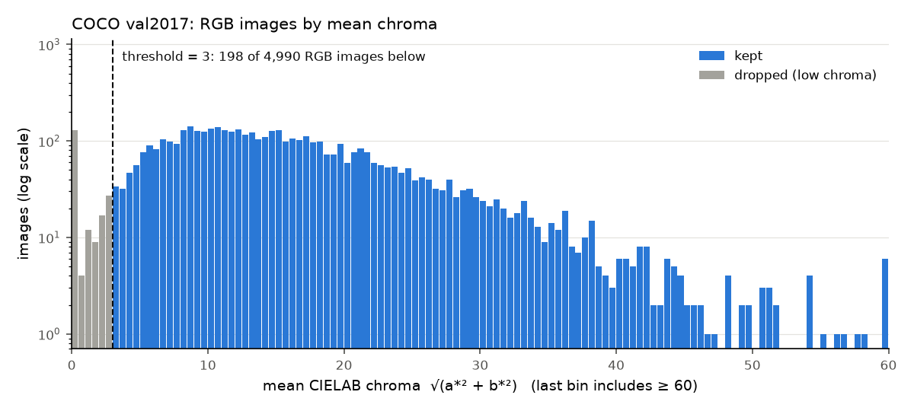

# Image Colourisation using MambaIRv2

**Author:** Johnathan Ngo
**Student ID:** 48897668
**Difficulty:** Hard

## Mamba Architecture
[placeholder]


## Feasibility Review
### User Need, Scope & Acceptance Criteria
[placeholder]


### Model Choice
[placeholder]


### Preliminary Evidence of Feasibility
[placeholder]


### Risks
[placeholder]


### Budget & Fallback
[placeholder]


## Dependencies
[placeholder]

## Dataset and Preprocessing
The model is trained on [COCO 2017](https://cocodataset.org/#download): `train2017.zip`, `val2017.zip` and `annotations_trainval2017.zip` go in `data/`, which is gitignored. A colouriser learns from colour targets, so images that carry little or no colour are filtered out first.

[`scripts/build_manifest.py`](scripts/build_manifest.py) reads each image straight from the zip and records its size, PIL mode and **mean chroma**. Mean chroma is the per-pixel mean of $\sqrt{a^{*2} + b^{*2}}$ in CIELAB (sRGB, D65). It then drops:

* **non-RGB images** (mode `L`, CMYK, palette, ...)
* **small images** whose short side is under 256 px
* **near-grey or sepia images** whose mean chroma is below 3

```bash
python -I scripts/build_manifest.py data/train2017.zip data/val2017.zip \
    --out-dir ../../../coco_manifest --chroma-threshold 3 --hist assets/chroma_histogram.png
```

The manifest (`manifest_<split>.csv`, one row per image with `keep` and `drop_reason`) and `summary.json` are written outside the repo. Only the script is committed.

### Choosing the chroma threshold


The histogram has a spike below 0.5, which is greyscale images stored as RGB, and a dip at 0.5–1. After that, counts climb smoothly into the main colour mass, so the histogram alone shows no natural cutoff for near-grey images. To place one, I inspected random samples from each chroma band:

* **0.5–2.5:** mostly black-and-white or toned photos (vintage prints, B&W street scenes, a sepia still life), plus a few very muted colour scenes (snow, dark rooms).
* **2.5–3.5:** mostly genuine colour with a muted palette (overcast sky, snow, white bathrooms), with the occasional B&W photo.
* **Above 3.5:** genuine colour, apart from occasional sepia-toned photos.

The threshold is set at **3**, where B&W images stop being common. Dropping a few muted colour photos is a cheap price compared with training on grey targets. Strongly toned sepia (chroma around 4–5) overlaps the low end of genuine colour, so a mean-chroma threshold can't remove it without cutting real colour images. A small number of sepia images therefore stays in the training set.

### Filtering counts
| Split | Before | Non-RGB | Short side < 256 | Chroma < 3 | After |
|---|---:|---:|---:|---:|---:|
| train2017 | _pending_ | | | | |
| val2017 | 5,000 | 10 | 42 | 208 | 4,752 |

An image can fail more than one check (for example, every mode-`L` image also has chroma 0), so the drop columns add up to more than *Before − After*.

## Training Procedure
[placeholder]

### Loss Function
[placeholder]

## Results
[placeholder]

## AI Usage Disclosure
[placeholder]
