# VQ-VAE2 on HipMRI Dataset

**Author:** Johnathan Ngo\
**Student ID:** s4889766\
**Difficulty:** Hard

## VQ-VAE2 Architecture
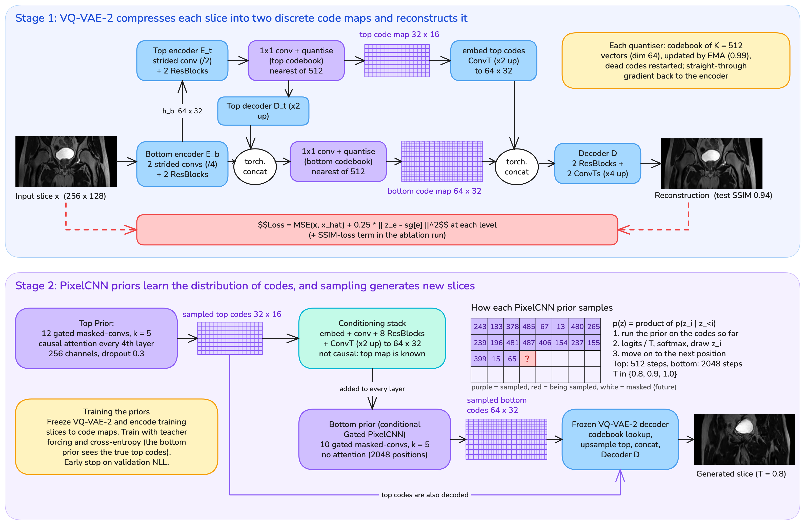

*The two stages of VQ-VAE-2 as implemented in `modules.py`.*

VQ-VAE-2 (Razavi et al., 2019) generates images in two stages. In stage 1 (top half of the figure), a hierarchical autoencoder turns each 256×128 slice into two grids of discrete codes. The bottom encoder downsamples the slice 4× with strided convolutions and residual blocks, and the top encoder downsamples it a further 2×. Each level then replaces every latent vector with the nearest of its 512 learned 64-dimensional codes. This gives a 32×16 top code map for the global layout and a 64×32 bottom code map for local detail. The bottom level is quantised only after it sees the decoded top codes, so it can focus on what the top level misses. The decoder upsamples the top codes, concatenates them with the bottom codes and reconstructs the slice. Gradients pass the nearest-code lookup by the straight-through estimator, and the codebooks are updated by moving averages rather than by gradient (see Training). Setting `levels: 1` removes the top level, which gives the single-level baseline.

Stage 2 (bottom half) learns which code maps are likely, using gated PixelCNN priors (van den Oord et al., 2016) that predict each code from the codes before it in raster order. The top prior has 12 masked-convolution layers (kernel 5, 256 channels) with causal self-attention after every fourth layer, so each code can attend to the whole layout drawn so far. The bottom prior has 10 layers and no attention, which would be costly in memory over 2,048 positions. Instead, it receives the top codes through a conditioning stack of 8 residual blocks and a 2× upsample, added to every layer. To generate a slice, the top prior draws 512 codes one at a time, the bottom prior draws 2,048 codes given them, and the frozen stage-1 decoder turns both maps into an image. Before each draw, the logits are divided by a temperature $T$, which trades realism against variety. The baseline's single prior has the same design as the top prior, applied to its 64×32 map. Each prior has about 52M parameters, against 1.71M for the stage-1 model.


## Dependencies & Usage
The code needs Python 3.11 or newer, which the pinned numpy and scipy require. These are the packages it imports directly, at the versions used for the results:

| Package | Version | Used for |
|---|---|---|
| torch | 2.12.1 (CUDA 13.0 build) | Models, training and sampling |
| numpy | 2.4.6 | Array handling |
| nibabel | 5.4.2 | Reading the NIfTI slices |
| torchmetrics | 1.9.0 | SSIM, PSNR and the Inception-v3 feature extractor |
| torch-fidelity | 0.4.0 | Inception-v3 weights for FID |
| scipy | 1.17.1 | Matrix square root in FID |
| scikit-learn | 1.9.1 | PCA and t-SNE |
| matplotlib | 3.11.1 | Figures |
| PyYAML | 6.0.3 | The config file |
| tqdm | 4.70.1 | Progress bars |

**Environment.** Create a conda environment with these versions:

```bash
conda create -n vqvae2 python=3.12
conda activate vqvae2
pip install torch==2.12.1 torchvision==0.27.1 --index-url https://download.pytorch.org/whl/cu130
pip install numpy==2.4.6 nibabel==5.4.2 torchmetrics==1.9.0 torch-fidelity==0.4.0 \
    scipy==1.17.1 scikit-learn==1.9.1 matplotlib==3.11.1 PyYAML==6.0.3 tqdm==4.70.1
```

The `--index-url` installs the CUDA 13.0 build used on Rangpur. torchvision is not imported directly, but torch-fidelity needs it, so it is installed from the same index to match torch. On a machine without an NVIDIA GPU, leave out the `--index-url`. The code then runs on Apple's MPS backend or the CPU.

`requirements.txt` is the full environment frozen on the Rangpur cluster.


**Data.** Set `data.root` in `configs/vqvae2.yml`, or pass `--root`, to the folder holding `keras_slices_train`, `keras_slices_validate` and `keras_slices_test`. The default is the copy on Rangpur. The first run preprocesses every slice and caches each split under `~/.cache/hipmri_vqvae2` (or `$HIPMRI_CACHE`), so later runs skip the decoding.

```bash
python dataset.py ROOT                # slices and patients per split, and the patient-leakage check
python scripts/inspect_data.py ROOT   # the slice grid and intensity histogram below
python scripts/check_modules.py       # shape, gradient and codebook checks on random input
python scripts/check_priors.py        # causality and conditioning checks for the priors
```

**Training.** The commands are listed under Training. Each stage-1 run is saved to `checkpoints/vqvae2_L<levels>_ssim<weight>/`, and its code maps and priors are saved inside it.

**Evaluation.** `predict.py` takes a stage-1 run directory. Each task writes its numbers to `<run>/eval/<task>.json` and its figures to `assets/`.

```bash
RUN=checkpoints/vqvae2_L2_ssim0.01
python predict.py all $RUN                     # reconstruct, sample, audit, fid and interpolate
python predict.py sample $RUN --temperatures 1.1 --bottom-temperatures 0.5
python predict.py audit $RUN                   # audit and fid score every saved setting
python predict.py fid $RUN
python predict.py autopsy $RUN --setting 1.1/0.5
python predict.py resources checkpoints/vqvae2_L2_ssim0 checkpoints/vqvae2_L1_ssim0
python predict.py report checkpoints/vqvae2_L2_ssim0 checkpoints/vqvae2_L1_ssim0 $RUN  # assets/results.md
python scripts/plot_results.py assets/results.md   # comparison plots in assets/results/
```

## Dataset and Preprocessing
The data are the 2D slices of the HipMRI study (Dowling & Greer, 2021): weekly MR scans of the male pelvis from 38 patients in a prostate cancer study. Each scan is a stack of 60 coronal slices of 256×128 pixels, stored one slice per NIfTI file. Patients have between one and eight weekly scans, 211 in all. The dataset comes split by patient, and `dataset.py` checks that no patient appears in two splits.

| Split | Patients | Scans | Slices |
|---|---|---|---|
| Train | 31 (004–033, 035) | 191 | 11,460 |
| Validate | 4 (036–039) | 11 | 660 |
| Test | 3 (040–042) | 9 | 540 |

- **The training slices hold fewer independent views than their count suggests.** The weekly scans of one patient show the same anatomy, and 21 of the 31 training patients contribute all eight weeks. A model therefore sees each of those patients' anatomy eight times per epoch, which raises the risk of memorisation.
- **One patient dominates the test set.** Patient 040 has seven scans, 420 of the 540 test slices.
- **The masks are unused.** The dataset also includes segmentation masks, which this project does not use.

`dataset.py` preprocesses each slice in four steps:

1. **Load.** Each slice is read with nibabel as float32, and the stray third dimension some files carry is dropped.
2. **Fit to 256×128.** One training scan (patient 019, week 1) is 256×144. Its pixel spacing matches the rest, so it is centre-cropped rather than resized, which keeps its anatomy at the same scale.
3. **Normalise per slice.** MR intensities have no fixed scale between scans. Each slice is clipped at its own 99.5th percentile, so a few very bright pixels do not compress the rest, then min-max scaled to [0, 1].
4. **Cache.** Each preprocessed split is saved as one tensor file (about 1.5 GB for the training split) and reloaded on later runs. The cache is rebuilt if the files, the size or the clip percentile change.

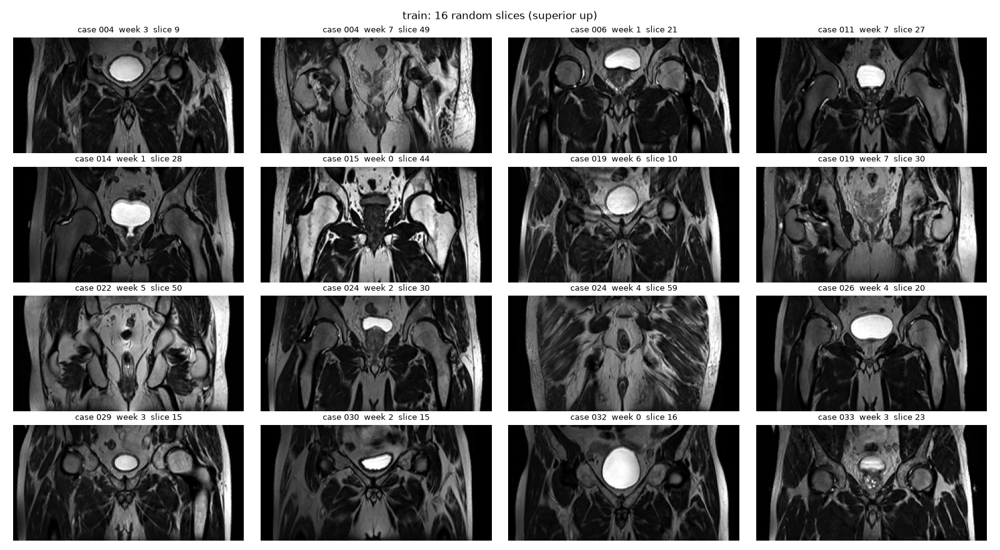

*Sixteen random training slices after preprocessing, labelled by patient (case), week and slice index.*

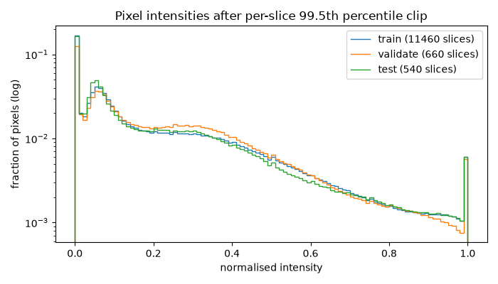

*Pixel intensities after preprocessing, for each split, on a log scale.*

- **The splits have similar intensity distributions.** In each, 8–10% of pixels are exactly 0 (the background) and 0.5% are clipped to 1 by construction. The validation slices are slightly brighter, with a median slice mean of 0.24 against 0.21 for training and 0.20 for test.
- **A training slice's mean intensity ranges from 0.11 to 0.38,** with a median of 0.21. The failure autopsy uses this range to spot over-bright samples.
- **Position in the stack changes the anatomy.** The early and middle slices show the bladder between the femoral heads, while the late slices show mostly bowel, bone and muscle, and are brighter.

## Training
Both models are trained by `train.py` in three steps, with the settings in `configs/vqvae2.yml`. Every run used seed 0 and one NVIDIA A100 (40 GB) on the Rangpur cluster. The data are split by patient: 11,460 slices from 31 patients for training and 660 from 4 for validation. The validation slices only pick checkpoints and stop training. The three test patients are held back for the Results.

**Stage 1: the VQ-VAE.** Adam (learning rate $3 \times 10^{-4}$, batch 64) minimises

$$\mathcal{L} = \lVert x - \hat{x} \rVert_2^2 + \beta \sum_\text{levels} \lVert z - \mathrm{sg}[e] \rVert_2^2 + w\bigl(1 - \mathrm{SSIM}(x, \hat{x})\bigr), \qquad \beta = 0.25,$$

with $w = 0$ for VQ-VAE-2 and the baseline, and $w = 0.01$ for the SSIM-loss variant. The codebooks get no gradient. Each code follows an exponential moving average (decay 0.99) of the encoder outputs assigned to it, and a code used less than about once per batch is restarted at a random encoder output. Training is stopped early on validation SSIM, as described under Early stopping below.

**Encoding.** The kept stage-1 checkpoint is frozen and turns every slice into code maps: 32×16 top and 64×32 bottom codes for VQ-VAE-2, and a single 64×32 map for the baseline.

**Stage 2: the priors.** Each prior learns to predict every code from the codes before it in raster order, by cross-entropy on the true code maps (teacher forcing). The top prior and the baseline's single prior are unconditional, and the bottom prior also sees the true top codes. Each is trained by Adam (learning rate $3 \times 10^{-4}$, batch 32) with dropout 0.3. Training is stopped early on the validation negative log-likelihood (NLL, in bits per code).

```bash
python train.py                          # stage 1, VQ-VAE-2
python train.py --stage top              # encodes every split, then trains the top prior
python train.py --stage bottom           # bottom prior
python train.py --levels 1               # stage 1, baseline
python train.py --levels 1 --stage bottom
python train.py --ssim-loss-weight 0.01  # stage 1, SSIM-loss variant; its priors take the same flag
```

| Model | Component | Parameters | Epochs run (kept) | Time (h) | Peak VRAM (GB) |
|---|---|---|---|---|---|
| VQ-VAE-2 | Stage 1 | 1.71M | 51 (41) | 0.10 | 1.6 |
| VQ-VAE-2 | Top prior | 52.39M | 15 (5) | 0.15 | 3.1 |
| VQ-VAE-2 | Bottom prior | 51.80M | 16 (6) | 0.49 | 8.0 |
| Baseline (1 level) | Stage 1 | 0.82M | 48 (38) | 0.07 | 1.3 |
| Baseline (1 level) | Prior | 52.78M | 15 (5) | 0.61 | 9.9 |

*Training cost of the plain VQ-VAE-2 and the baseline on the A100.*

Each pipeline trains in about 40–45 minutes, most of it spent on the priors.

### Stage 1 curves
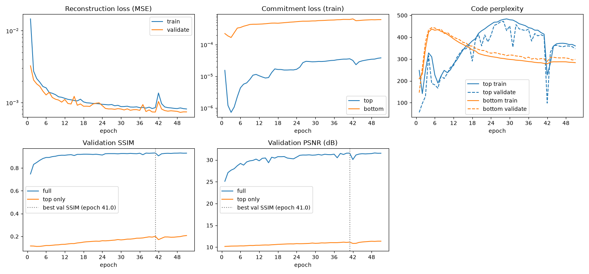

*VQ-VAE-2's stage-1 training. Top row: reconstruction loss, commitment loss and codebook perplexity for each level. Bottom row: validation SSIM and PSNR for the full reconstruction and for the top level decoded alone. The dotted line marks the highest validation SSIM.*

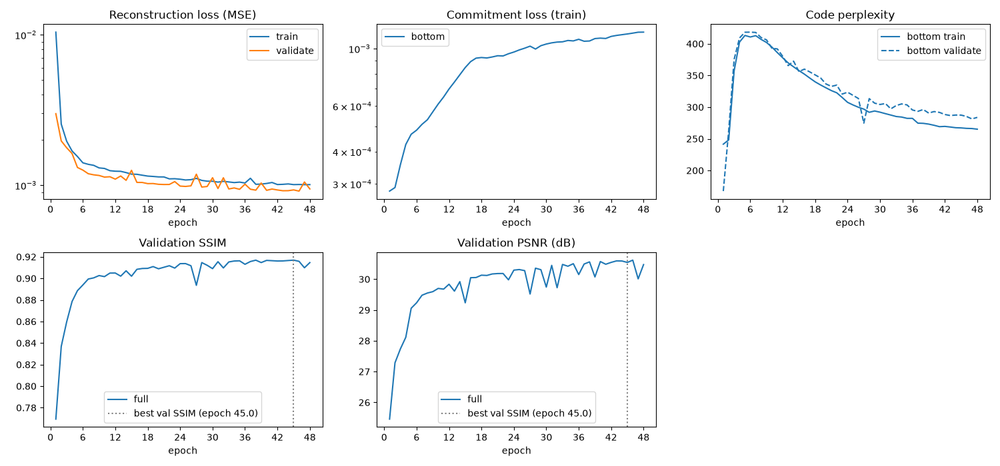

*The baseline's stage-1 training, in the same layout.*

- **Neither model overfits in stage 1.** Validation MSE stays close to training MSE for the whole run, mostly just below it.
- **Most of the gain comes early.** Validation SSIM climbs steeply for about 10 epochs and is nearly flat after epoch 20.
- **VQ-VAE-2's top codebook briefly collapsed at epoch 42.** Its validation perplexity fell from about 410 to 100 for one epoch, while the reconstruction loss jumped and validation SSIM dipped. Both recovered within two epochs, and the bottom codebook barely moved. The checkpoint used in the Results is from epoch 41, just before the collapse, and no later epoch beat it.
- **Code use rises, then narrows, without collapsing.** In both models, bottom perplexity peaks above 400 around epoch 5, then falls slowly to 265–300 of 512. VQ-VAE-2's top perplexity is noisier and peaks later, near 480 at epoch 29.
- **The top level alone stays weak.** Decoded on its own, it rises only from 0.12 to about 0.2 validation SSIM over training. This is the near-black top-only reconstruction shown in the Results.
- **The commitment loss rises steadily after the first few epochs** in both models, meaning the encoder outputs drift further from their nearest codes as training goes on. The reconstruction loss still falls over the same epochs.

### Prior curves
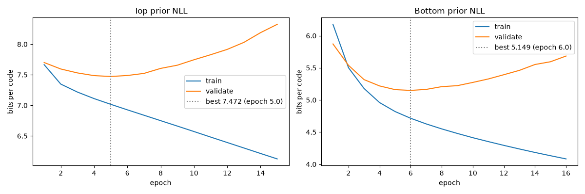 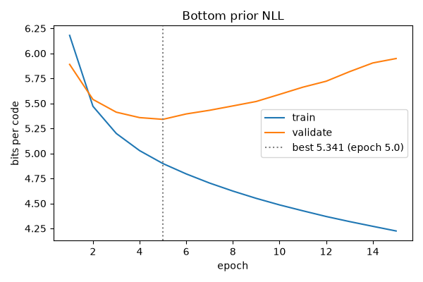

*Training and validation NLL in bits per code for VQ-VAE-2's top and bottom priors (left) and the baseline's single prior (right). The baseline's prior models its only level, a 64×32 map, so its plot is titled "Bottom prior". The dotted line marks the lowest validation NLL, which is the kept checkpoint. A uniform guess over 512 codes costs 9 bits.*

- **Every prior overfits within six epochs.** Validation NLL is lowest at epoch 5 or 6: 7.47 bits per code for the top prior, 5.15 for the bottom prior and 5.34 for the baseline's. After that, it rises while the training NLL keeps falling. By the last epoch, the top prior's gap is 2.2 bits (6.1 against 8.3).
- **Top codes are harder to predict.** Each costs 7.47 bits, only 1.5 below a uniform guess, against 5.15 for a bottom code. A top code covers an 8×8 patch of the slice rather than 4×4, and the bottom prior has the top codes to guide it.

### Early stopping
Every training stage uses the same rule, in `fit` in `train.py`. After each epoch, the model is scored on the whole validation split. If the monitored metric beats the best so far by more than a threshold, the model is saved as the kept checkpoint and a counter resets. Otherwise the counter goes up, and training stops when it reaches 10 epochs (the patience). Stage 1 monitors validation SSIM with a threshold of $10^{-4}$, and the priors monitor validation NLL with a threshold of $10^{-3}$ bits per code. A second checkpoint, saved every epoch with the counter, lets an interrupted run resume where it left off. No run came near the 100-epoch cap.

For the priors, it is the main guard against overfitting. With about 52M parameters each and only 11,460 training code maps, the priors overfit within six epochs despite a dropout of 0.3. Their validation NLL rose in every epoch after the best one, so each kept its epoch-5 or epoch-6 checkpoint. This is the mitigation the feasibility review planned for its memorisation warning sign, a rising validation NLL. It limits memorisation but cannot rule it out, so the samples are audited in the Results.

## Results
Stage 1 comes first: how well each model reconstructs patients it never saw. The samples from stage 2 follow, judged on realism and memorisation, and the section ends with latent interpolations.

### Reconstruction
Each model reconstructed the 540 slices of the three test patients. Reconstructions are scored against the originals by SSIM (Wang et al., 2004) and PSNR.

| Model | SSIM | PSNR (dB) | Top-only SSIM | Codebook perplexity (top / bottom) |
|---|---|---|---|---|
| Baseline (1 level) | 0.929 ± 0.012 | 31.13 ± 1.53 | – | – / 255 |
| VQ-VAE-2 | 0.941 ± 0.009 | 32.13 ± 1.54 | 0.224 ± 0.047 | 383 / 260 |
| VQ-VAE-2 + SSIM loss | **0.953 ± 0.009** | **32.49 ± 1.58** | 0.226 ± 0.048 | 391 / 287 |

*Mean ± SD over the test slices. Perplexity is the effective number of codes in use, out of 512.*

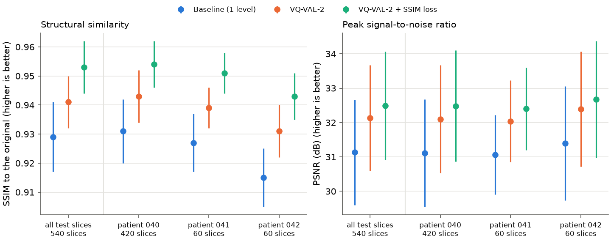

*Each dot is a model's mean over the test slices, overall (left of the divider) and per patient; the bars span ±1 SD.*

- **Every model clears the fidelity criterion (SSIM > 0.6) by a wide margin.** Even the baseline's worst test slice scores 0.900.
- **VQ-VAE-2 reconstructs better than the baseline on every test patient.** Overall it gains 0.012 SSIM and 1.0 dB PSNR. The gap is about one SD, so the two spreads overlap, but the order holds for all three patients. VQ-VAE-2 also has twice the stage-1 parameters (1.71M against 0.82M), so part of the gain may come from capacity rather than from the second level.
- **Inception features agree.** FID compares Inception-v3 features (Szegedy et al., 2016) of two image sets. VQ-VAE-2's reconstructions score an FID of 78.2 against the training slices, against 87.6 for the baseline's. The real test slices score 62.6.
- **The SSIM loss adds a further 0.012 SSIM and 0.4 dB.** It also spreads the bottom level over more of its codebook (perplexity 287 against 260).
- **No codebook collapsed onto a few codes,** the risk named in the feasibility review. Perplexity stays between 255 and 391 of 512 at every level.

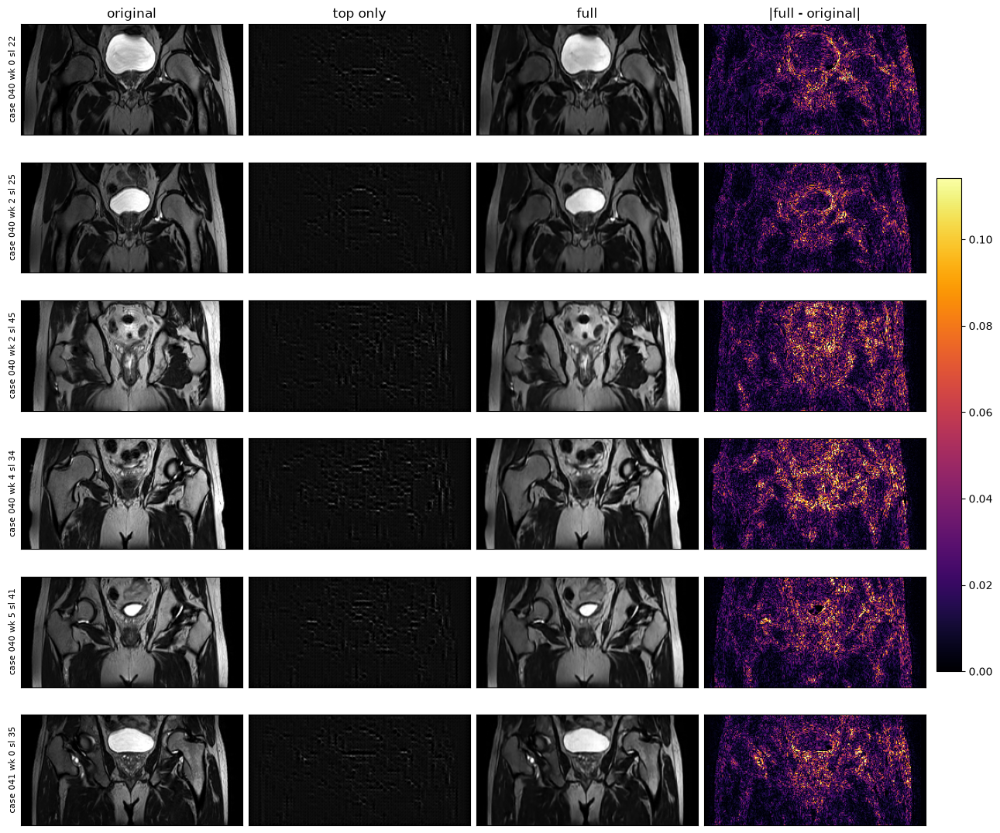

*VQ-VAE-2 on six test slices: the original, the top level decoded alone (bottom codes set to zero), the full reconstruction and its absolute error.*

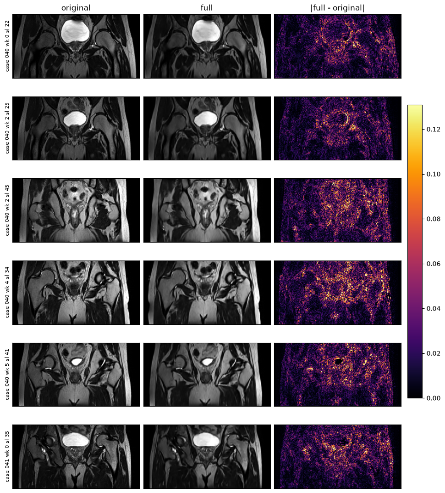

*The baseline on the same six slices. Each error map's colour scale stops at that figure's 99.5th-percentile error, about 0.11 for VQ-VAE-2 and 0.13 for the baseline, so compare the two by their colour bars.*

- **The errors sit on fine structure.** In both models, they concentrate on tissue edges and the textured centre of the pelvis, such as the bowel loops and the bladder wall. The background and flat muscle are almost error-free. The reconstructions lose some fine texture, not anatomy.
- **The top level alone reconstructs almost nothing** (SSIM 0.22, a near-black frame), so the decoder draws nearly all of its content from the bottom codes. Zeroed bottom codes are an input the decoder never saw in training, so this understates what the top level holds. Its main role shows up in sampling instead: the bottom prior is conditioned on the top codes, which is why $T_\text{top}$ changes the layout of samples in the separate-temperature sweeps below.

### Latent interpolation
Interpolation tests whether the latent space is continuous. Each model was given the same four pairs of test slices, taken from different patients at the same slice index. For each pair, the two slices' encoder outputs are blended before quantisation, $(1 - a)\,z_A + a\,z_B$, for nine values of $a$ from 0 to 1. Each blend is then quantised and decoded.

Smoothness is measured as the change between consecutive frames, 1 − SSIM. A jump would show as one step much larger than the rest, so each path is scored by its largest step divided by its median step.

| Model | Largest / median step (mean ± SD over 4 pairs) | Worst pair |
|---|---|---|
| Baseline (1 level) | 1.14 ± 0.04 | 1.19 |
| VQ-VAE-2 | 1.18 ± 0.10 | 1.31 |

*A ratio of 1 means every step in the path is the same size.*

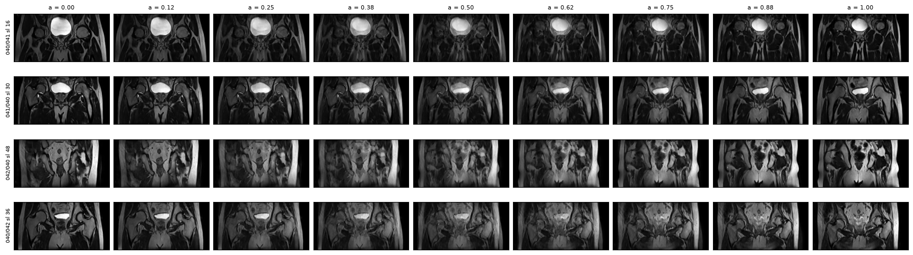

*VQ-VAE-2 interpolations between four pairs of test slices, labelled by the two patients and the slice index, with the blend weight $a$ above each column.*

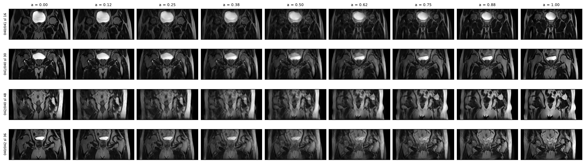

*The baseline's interpolations between the same four pairs.*

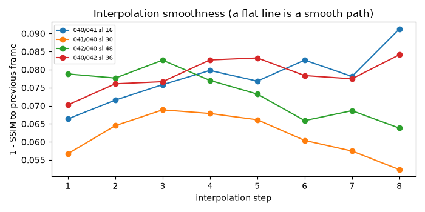 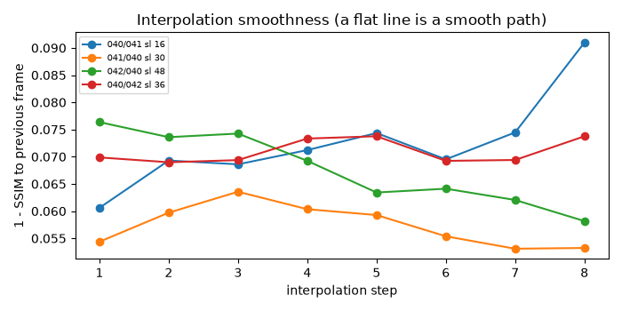

*The change between consecutive frames along each path, for the baseline (left) and VQ-VAE-2 (right).*

- **Neither model jumps.** In both grids, each frame differs only slightly from the one before it, and no frame suddenly switches from one slice to the other. Every step changes the frame by 0.05–0.09 (1 − SSIM), and no step is more than 1.31 times its path's median. The interpolation part of the diversity criterion is met.
- **The two models behave alike.** The baseline's frames look almost the same as VQ-VAE-2's. Both have their largest step in the same place, the last step of the 040/041 pair (0.091). That step reflects the pair rather than either model.


### Shared sampling temperature
Every sampling setting in this and the following sections draws 512 samples from the same seed. Two measures are used throughout:

- **FID** against the 11,460 training slices, where lower is more realistic. Real slices from the three unseen test patients score 62.6, roughly where a generator of genuinely new patients would sit.
- **The nearest-neighbour audit.** For each sample, this is the SSIM to its most similar training slice. The reference is the same measure for the test patients' slices, passed through the same decoder so that its blur affects both sides equally. A sample is **flagged** when it is closer to a training slice than any test slice gets (the reference maximum, 0.435–0.439 depending on the model). A flagged sample is closer to the training data than a new patient's scan is, which is the signature of memorisation.

Each model was first sampled with one temperature, $T$, shared by all of its priors. Three models are compared: the single-level baseline, VQ-VAE-2, and VQ-VAE-2 trained with an extra SSIM term in its reconstruction loss (weight 0.01).

| Model | $T = 0.8$ | $T = 0.9$ | $T = 1.0$ |
|---|---|---|---|
| Baseline (1 level) | 150.1 | **138.1** | 161.4 |
| VQ-VAE-2 | **130.0** | 147.7 | 186.1 |
| VQ-VAE-2 + SSIM loss | **120.1** | 129.5 | 159.0 |

*FID against the training slices (lower is better), with each model's best in bold.*

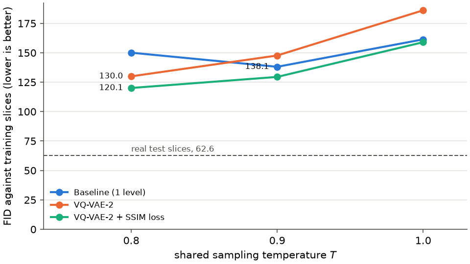

- **At its best temperature, each two-level model beats the baseline.** VQ-VAE-2 reaches 130.0 and the SSIM-loss model 120.1, against 138.1 for the baseline.
- **The two-level model is more sensitive to temperature.** It is best at 0.8 and worst at 1.0, where it falls behind the baseline (186.1 against 161.4). A likely reason is that both of its priors sample at $T$, so a hot setting gives a less coherent layout and then noisier texture on top of it.
- **The SSIM loss lowers FID at every temperature,** by 9.9 at 0.8, 18.2 at 0.9 and 27.1 at 1.0.
- **Every model remains far from the floor.** The best score (120.1) is nearly twice the 62.6 of real test slices. The decoder accounts for only part of that gap: the plain VQ-VAE-2's reconstructions of the test slices score 78.2. Most of it therefore comes from the priors.

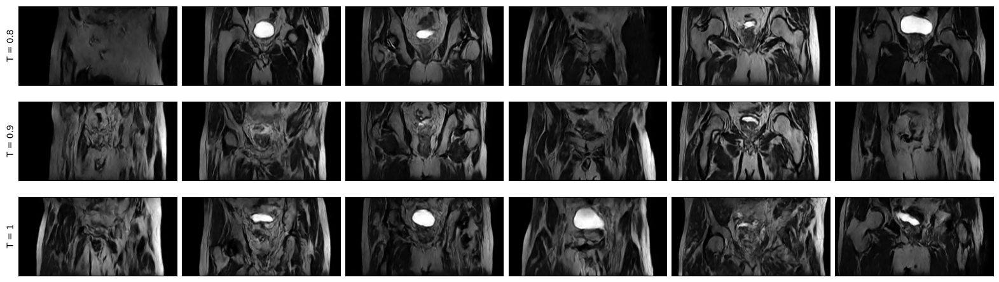

*Uncurated samples from the baseline: the first six of 512 at each temperature.*

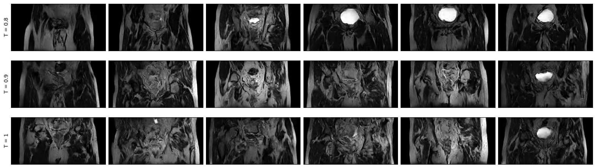

*Uncurated samples from VQ-VAE-2, laid out the same way.*

The grids match the scores. At $T = 0.8$, half of the VQ-VAE-2 samples show a bright bladder inside a recognisable pelvis, with the femoral heads on either side. At 0.9 and 1.0, most become a tangle of tissue texture with no clear organs. The baseline's samples are smoother and lower in contrast, several frames are foggy, and some of its bladders at $T = 1.0$ are misshapen.

### Memorisation
At a lower temperature, the priors favour their most likely codes, and those are the codes that rebuild training slices. Realism and memorisation can therefore rise together, so every setting was audited.

**Where the samples sit.**

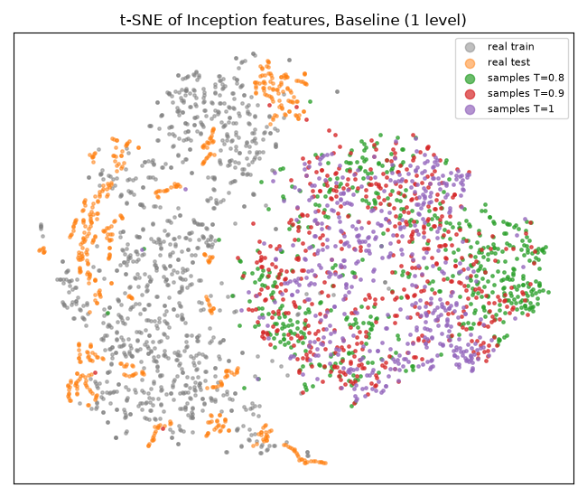 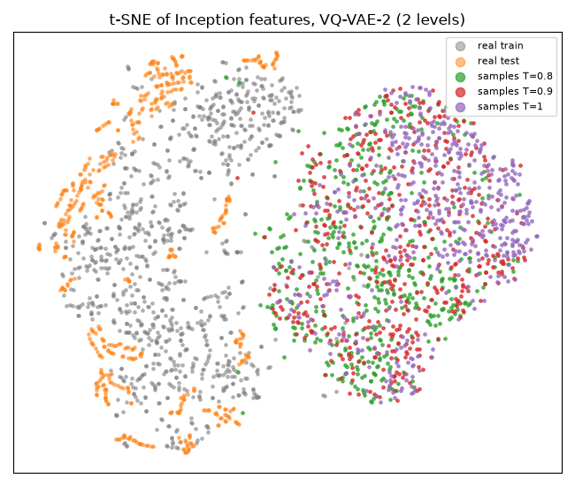

*t-SNE (van der Maaten & Hinton, 2008) of Inception features for the training slices (grey), the test slices (orange) and the samples at each temperature, for the baseline (left) and VQ-VAE-2 (right).*

- **No sample lands on a training slice.** In both models, the samples form their own cloud beside the real slices. A memorising model would instead place samples on top of individual training points.
- **The gap between the clouds is the realism gap that FID measures.** Inception features still separate generated slices from real ones. The test slices, in contrast, sit along the edge of the training cloud in short streaks, likely runs of neighbouring slices from one patient.
- **There is no sign of mode collapse.** The three temperatures overlap within the sample cloud rather than splitting into tight clusters. VQ-VAE-2's $T = 1.0$ samples drift to the far side, away from the real data, in line with their FID of 186.1.

**How close the samples get.**

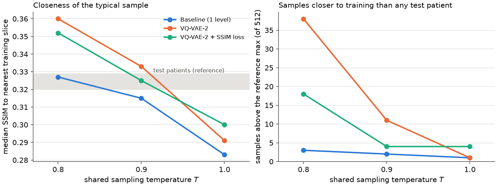

*Left: the median SSIM between a sample and its nearest training slice; the grey band is the same median for the test patients. Right: the number of samples closer to a training slice than any test slice gets.*

- **VQ-VAE-2 at $T = 0.8$ is closer to the training set than a new patient is.** Its typical sample has a median nearest-train SSIM of 0.360, against 0.324 for the typical test slice. 38 of its 512 samples (7%) are flagged. Both measures fall as $T$ rises, to 11 flagged at 0.9 and 1 at 1.0.
- **The SSIM loss halves the flags at $T = 0.8$** (18), while also improving FID.
- **The baseline stays at or below the reference at every temperature,** with 1–3 samples flagged. Its weaker prior produces samples that are further from every real slice, not only from the training slices.

Under a shared temperature, the setting where the two-level model is most realistic is therefore also the one where it is closest to its training data.

**What a flagged sample looks like.**

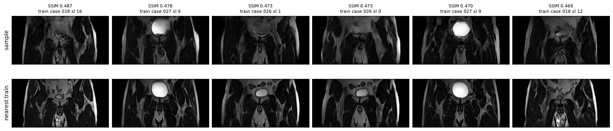

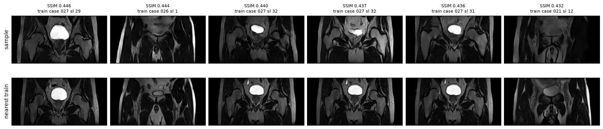

*The six samples closest to the training set at $T = 0.8$ (top row of each figure), above their nearest training slice (bottom row). The first figure is VQ-VAE-2 and the second is the baseline.*

- **None is a copy.** The flagged samples share their neighbour's layout, such as the size and position of the bladder and the pelvic outline, but not its detail.
  - Their SSIM is 0.47–0.49. The decoder's reconstruction of a slice scores 0.94 against the original, which is roughly what a copy would score.
  - At the code level, no sample matches a training slice exactly. The closest shares 18.9% of its top codes and 29.1% of its bottom codes with a training slice, against 11.1% and 20.1% for the test slices.
- **The closest samples come from few patients.** VQ-VAE-2's six trace back to three training patients (018, 026 and 027). Four of the baseline's six trace back to slices 29–32 of patient 027.
- **The baseline has favourite patients too, even though few of its samples are flagged.** At the code level it is the closer model: its closest sample shares 33.8% of its codes with a training slice, against 29.1% for VQ-VAE-2's bottom level and 20.2% for the test slices.

### Separate temperatures
A shared temperature ties together two different choices. The top prior decides the layout and the bottom prior the texture. Cooling both to sharpen the texture also pulls the layouts toward the training set. Cooling further makes things worse:

- **VQ-VAE-2 at $T = 0.7$:** FID barely moves (131.3), while the flagged samples double to 75.
- **VQ-VAE-2 at $T = 0.6$:** FID rises to 149.9, with 105 samples flagged.
- **Baseline at $T = 0.6$:** the model collapses (FID 268.3) into off-centre, mostly blank frames.

Giving each prior its own temperature separates the two choices. The top prior can stay warm for varied layouts, while the bottom prior runs cold for clean texture. `predict.py sample --bottom-temperatures` samples every pairing of a top and a bottom temperature. Because every setting uses the same seed, settings that share $T_\text{top}$ also share their top code maps, so comparing them changes only the texture.

The first sweep used the SSIM-loss model, with $T_\text{top}$ and $T_\text{bottom}$ each in $\{0.7, 0.8, 0.9\}$:

| $T_\text{top}$ \ $T_\text{bottom}$ | 0.7 | 0.8 | 0.9 |
|---|---|---|---|
| 0.7 | 128.9 / 23 | 137.2 / 29 | 155.9 / 21 |
| 0.8 | 107.2 / 28 | 120.1 / 18 | 137.5 / 10 |
| 0.9 | **94.4 / 12** | 106.2 / 12 | 129.5 / 4 |

*Each cell gives the FID, then the number of flagged samples (of 512). The diagonal is the shared temperature.*

- **$T_\text{bottom}$ drives realism.** FID falls as $T_\text{bottom}$ falls, in every row.
- **$T_\text{top}$ drives memorisation.** Flags tend to fall as $T_\text{top}$ rises: at $T_\text{bottom} = 0.9$, they go from 21 to 10 to 4. A warm top prior keeps layouts away from the training set.
- **The best setting beats the best shared temperature on both measures.** At 0.9/0.7, FID is 94.4 with 12 flagged, against 120.1 with 18 at $T = 0.8$.
- **Both trends were still improving at the edge of the grid,** at the coldest bottom and the warmest top temperature, so the grid was extended in those directions.

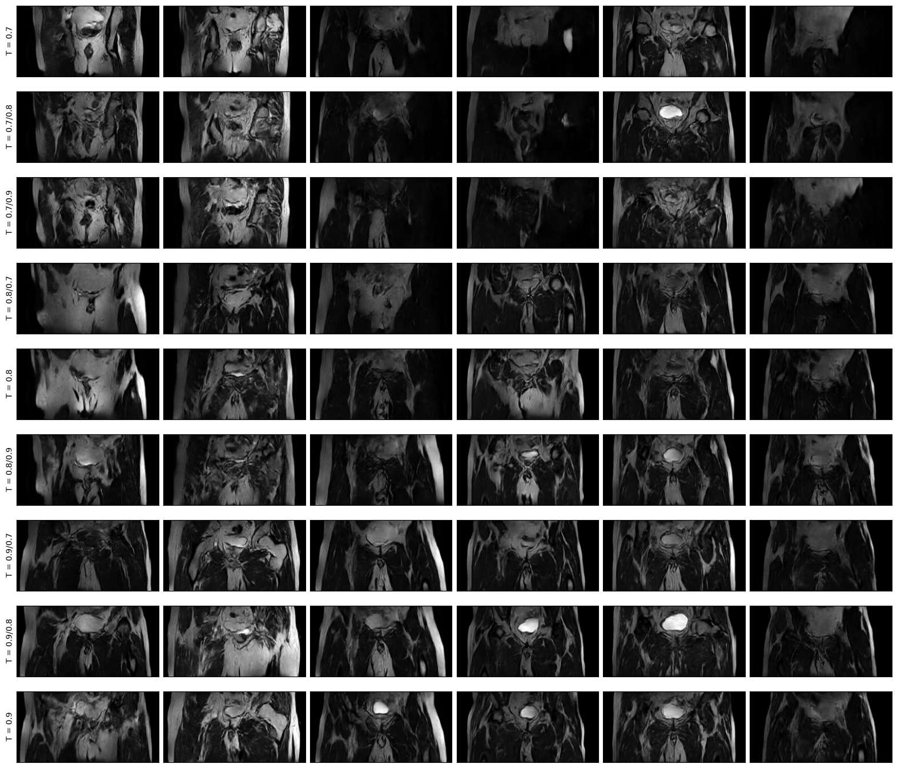

*Uncurated samples for each setting of the first sweep: the first six of 512. Rows with the same $T_\text{top}$ share their top codes, so each column keeps its overall layout across those rows and only the texture changes.*

### Extending the separate temperatures
The second sweep took $T_\text{top}$ up to 1.0 and 1.1 and $T_\text{bottom}$ down to 0.6 and 0.5. It reused the samples already drawn at 0.9/0.7. The full grid is below, in the same format as before.

| $T_\text{top}$ \ $T_\text{bottom}$ | 0.5 | 0.6 | 0.7 | 0.8 | 0.9 | 1.0 |
|---|---|---|---|---|---|---|
| 0.7 | | | 128.9 / 23 | 137.2 / 29 | 155.9 / 21 | |
| 0.8 | | | 107.2 / 28 | 120.1 / 18 | 137.5 / 10 | |
| 0.9 | 82.4 / 10 | 84.5 / 20 | 94.4 / 12 | 106.2 / 12 | 129.5 / 4 | |
| 1.0 | 77.3 / 11 | 81.7 / 11 | 93.3 / 4 | | | 159.0 / 4 |
| 1.1 | **77.9 / 0** | 85.3 / 2 | 96.4 / 6 | | | |

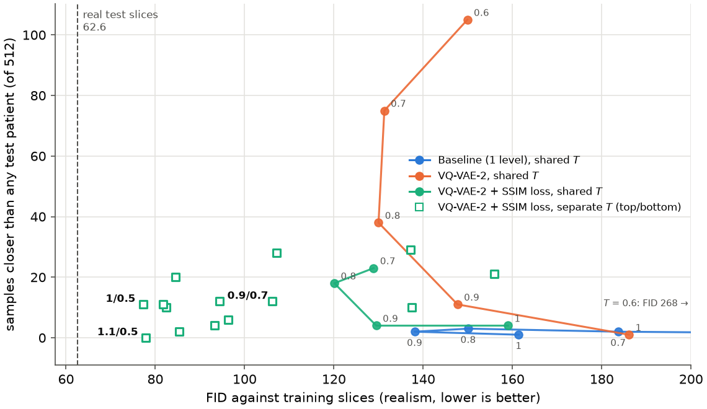

*FID against flagged samples for every setting. Lines join each model's shared temperatures in order; the squares are the SSIM-loss model's separate settings. The lower left is better on both counts.*

- **Shared temperatures soon stop paying off.** As $T$ falls, each shared-temperature curve first moves left, then turns. The two-level models turn upward, gaining flagged samples without further realism. The baseline turns back to the right as its samples degrade.
- **The separate settings sit below and to the left of every curve,** the baseline's included. The best of them reach FIDs of 77–82, which no shared temperature comes near for any model.

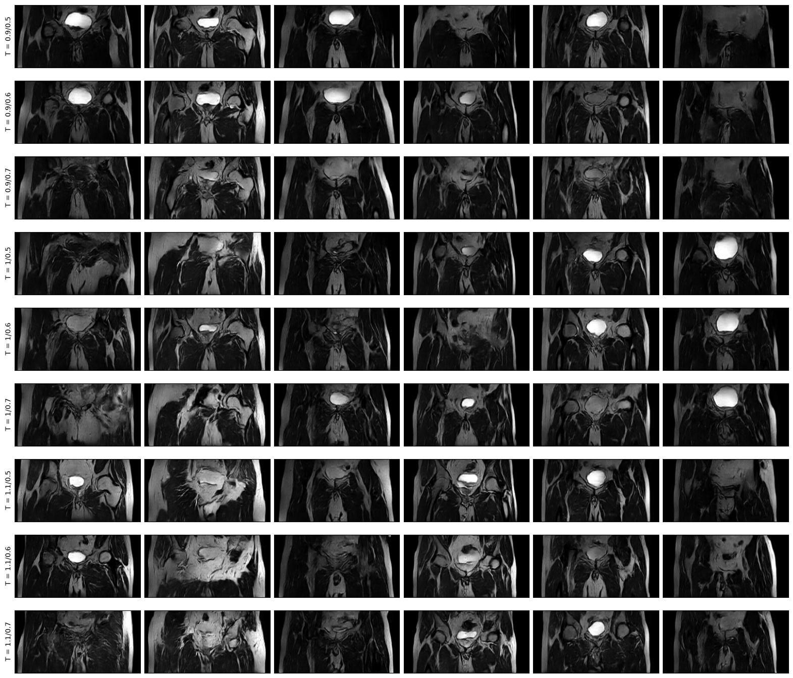

*Uncurated samples from the second sweep: the first six of 512 at each setting.*

Across the full grid, the two temperatures do different jobs:

- **$T_\text{bottom}$ sets realism.** In every row, FID falls as $T_\text{bottom}$ falls. At $T_\text{top} = 0.9$, it drops from 129.5 at $T_\text{bottom} = 0.9$ to 82.4 at 0.5.
- **$T_\text{top}$ sets novelty.** At a fixed $T_\text{bottom}$, the median nearest-train SSIM falls as $T_\text{top}$ rises. At $T_\text{bottom} = 0.7$, it goes from 0.360 at $T_\text{top} = 0.7$ to 0.302 at 1.1. Hotter top sampling produces layouts further from every training slice.
- **$T_\text{top}$ also matters for FID, up to a point.** At $T_\text{bottom} = 0.7$, raising $T_\text{top}$ from 0.7 to 0.9 lowers FID from 128.9 to 94.4, probably because colder top sampling repeats a narrower set of layouts. Above 0.9, FID is flat while novelty keeps improving.

**Recommendation: $T_\text{top} = 1.1$, $T_\text{bottom} = 0.5$.**

- **Realism:** its FID of 77.9 ties the lowest in the grid (77.3 at 1.0/0.5). One draw of 512 samples cannot resolve the 0.6 gap.
- **Memorisation:** no sample is closer to a training slice than the closest unseen test patient, against 11 at 1.0/0.5.
- **Novelty:** its median nearest-train SSIM (0.310) is below that of the test patients' reconstructions (0.321). The typical sample is therefore no closer to the training data than a new patient is.
- **Against the best shared temperature** ($T = 0.8$: FID 120.1, 18 flagged), FID falls by 42 and no samples are flagged.
- **Against the baseline at its best** ($T = 0.9$: FID 138.1, 2 flagged), FID falls by 60 and no samples are flagged.

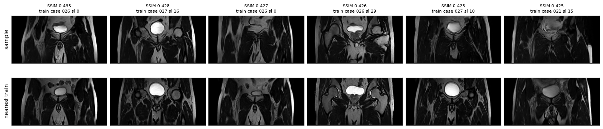

*The six samples closest to the training set at 1.1/0.5, above their nearest training slice.*

Even the closest samples at this setting stop at the reference maximum (SSIM 0.425–0.435). Like those at $T = 0.8$, they share only their neighbour's layout. They still trace back to the patients who dominated the shared-temperature audit, 026 and 027, which a patient-level audit should check.

**Caveats:**

- **Edge of the grid.** The optimum lies on the grid's edge: $T_\text{bottom} = 0.5$ is the coldest setting tried and $T_\text{top} = 1.1$ the hottest. Better settings may therefore lie outside the grid. Any search beyond it should be judged on the audit as well as FID, because FID is measured against the training slices and would also reward copies.
- **Selection on the same samples.** The setting was chosen as the best of 18 on the same samples it is reported with, so its FID is optimistic. A fresh draw with a new seed should confirm it before it is quoted as final.
- **Code agreement.** The code-level audit does not fully clear this setting.
  - No sample shares more than 17.8% of its top codes, or 24.1% of its bottom codes, with any training slice. That is far from a copy.
  - Both figures are still above the test patients' 10.2% and 16.2%, so at the code level the samples sit closer to the training data than new patients do.

### Failure autopsy
The audits above look at the samples closest to the training set. The autopsy looks at the other end: the samples at 1.1/0.5 least like any training slice, meaning those with the lowest nearest-train SSIM. `predict.py autopsy` picks them by this fixed rule rather than by eye. It shows each one beside the same sample drawn at the other bottom temperatures, which share its top codes. A flaw that persists across them comes from the top prior, and one that changes comes from the bottom prior.

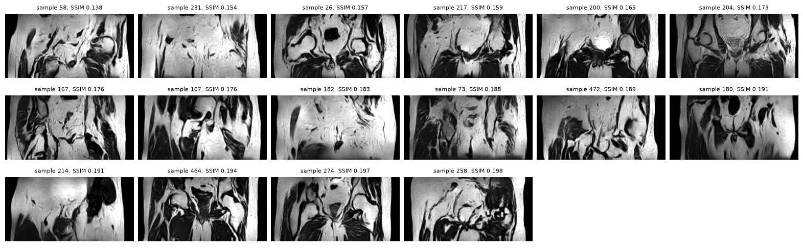

*The 16 samples at 1.1/0.5 least like any training slice, with their nearest-train SSIM.*

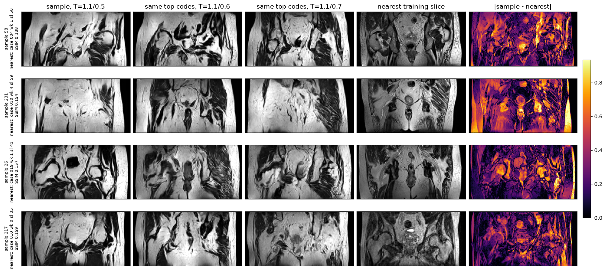

*The four least like any training slice. From left to right: the sample, the same top codes at $T_\text{bottom} = 0.6$ and $0.7$, the nearest training slice, and the absolute difference between the sample and that slice. Each row is labelled with the nearest slice's patient, week and slice number, and its SSIM.*

- All 16 are visibly broken: the body is washed out to near-white, and the organs are replaced by dark streaks and blotches. The femoral heads appear as distorted rings or not at all. Their nearest-train SSIM (0.14–0.20) is far below the test patients' typical 0.32. Ranking by SSIM could in principle pick plausible new slices instead, but here it picked genuine failures.
- **The samples are too bright.** Every slice is scaled to [0, 1], and the brightest of the 11,460 training slices has a mean intensity of 0.38.
  - 13 of the 16 samples exceed it (0.39–0.63). The other three are among the brightest 2% of training slices.
  - The uncurated samples at this setting sit at 0.11–0.28, around the training median of 0.21.
- **They sit beyond the bright edge of the training data.**
  - Their nearest training slices are among the brightest 6% of the training set.
  - Those slices come late in their volumes (slices 35–59 of 0–59), where training slices are brightest: the median intensity rises from 0.175 for slices 0–19 to 0.278 for slices 50–59.
  - The samples overshoot even these, and the difference maps show error across the whole body rather than at one structure.
- **The failure starts in the top codes.** With the same top codes, $T_\text{bottom} = 0.6$ and $0.7$ also give over-bright, broken slices (mean 0.40–0.53, still above every training slice). The body outline stays about the same, and only the interior detail changes, never into coherent anatomy. A colder bottom prior cannot rescue a bad top map. Whether the hot $T_\text{top}$ of 1.1 causes these failures needs the same autopsy at a cooler setting, such as 0.9/0.5.
- **At least 13 of the 512 samples (2.5%) fail this way.** This is a lower bound, since only the 16 lowest were inspected. Because these samples are brighter than any training slice, a simple check against the brightest training slice would catch most of them before samples are shared.

## Conclusion
Unless stated otherwise, the answers below refer to the SSIM-loss VQ-VAE-2 sampled at the recommended setting, $T_\text{top} = 1.1$ and $T_\text{bottom} = 0.5$.

### Against the Acceptance Criteria

| Criterion | Target | Result | Met |
|---|---|---|---|
| Fidelity | Test reconstruction SSIM > 0.6 | 0.953 ± 0.009, against 0.929 ± 0.012 for the baseline | Yes |
| Realism | FID below the baseline's | 77.9, against 138.1 for the baseline at its best | Yes |
| No memorisation | No sample with a high SSIM to a training slice | No sample is closer to a training slice than a test slice gets. The closest scores 0.435, against about 0.95 for a copy. No sample copies a training slice's codes. | Yes, at the image level |
| Diversity | No mode collapse, and no jumps in interpolations | No collapse in the t-SNE or the uncurated grids. No interpolation step exceeds 1.31 times its path's median. | Yes |

### Core Investigation Findings
- No sample at the recommended setting is closer to a training slice than an unseen patient's slice is.
- No sample in any of the 28 settings audited, across all three models, copies a training slice's codes exactly.
- The typical sample is as far from the training set as a new patient: its median nearest-train SSIM is 0.310, against 0.321.
- The novelty is not complete. At the code level the samples sit closer to the training data than new patients do: they share up to 17.8% of top and 24.1% of bottom codes with a training slice, against 10.2% and 16.2% for new patients. The closest samples also keep tracing back to the same two training patients, 026 and 027.

**Diverse: yes, with no sign of mode collapse.**
- At every shared temperature, the samples spread through their own region of the t-SNE rather than gathering into tight clusters.
- Each level of the codebook uses 255–391 of its 512 codes effectively.
- Interpolations between patients change smoothly, without jumps.
- At the recommended setting itself, the evidence for diversity is the uncurated grid and the audit, not a separate t-SNE. Its hot top temperature is the setting that pushes layouts furthest from the training set.

**Anatomically coherent: mostly, but not reliably.**
- Most uncurated samples show a recognisable pelvis, often with a bladder and femoral heads.
- At least 13 of the 512 samples (2.5%) are broken: brighter than any training slice and without coherent organs.
- An FID of 77.9 against 62.6 for real slices means Inception features can still tell samples from real scans. The plain VQ-VAE-2's own reconstructions score 78.2, which suggests the decoder's loss of fine texture is now a large part of the remaining gap.
- Anatomy was judged only by eye. There is no expert review and no measurement of organ shape or position.

**Compared with the single-level baseline:**
- **Fidelity:** both pass SSIM > 0.6 easily. VQ-VAE-2 is better on every test patient, and the SSIM loss widens the gap to 0.024 SSIM and 1.4 dB. VQ-VAE-2 also has twice the stage-1 parameters, so part of the gain may come from capacity.
- **Realism and coverage:** VQ-VAE-2 reaches an FID of 77.9 against the baseline's 138.1.
  - Even with one shared temperature, both two-level models do better: 120.1 with the SSIM loss and 130.0 without.
  - Separate temperatures need two priors, so part of the gain comes from the architecture itself.
  - The comparison does favour VQ-VAE-2 somewhat. It was tuned over 18 settings against the baseline's 5, and its best setting was chosen on the same samples it is reported with.
  - FID combines realism and coverage in one number. Separating them, for example with precision and recall (Kynkäänniemi et al., 2019), was not done.
- **Memorisation:** the baseline flags only 1–3 samples at each of its five temperatures. At the code level, though, it is the closer model: its samples share up to 36.0% of their codes with a training slice, against at most 31.8% for any VQ-VAE-2 sample at the same code-map size. At the recommended setting, VQ-VAE-2 flags none.

### Verdict
**Non-memorised: Yes, on every test run.** No sample copies a training slice at the image or code level. None is flagged at the recommended setting, and the typical sample is as novel as a new patient. Two loose ends remain: the code agreement above that of new patients, and the recurring patients 026 and 027, which a patient-level audit should check.

**Clinically plausible for downstream training: No.**
- **Broken samples:** at least 2.5% are broken and must be filtered out first. A brightness check catches most of them.
- **Realism gap:** the gap to real scans remains with FID 77.9 against FID 62.6 for test slices.
- **No labels:** the model generates images without segmentation masks, so it cannot supply labelled data for a segmentation task on its own.

**Overall:** VQ-VAE-2 answers the research question positively on novelty, diversity and fidelity, and beats the single-level baseline on fidelity and realism. The generated cohort is a non-memorised starting point but not yet a validated, or viable, substitute for real scans.

## AI Usage Disclosure
[placeholder]

## References
- Dowling, J., & Greer, P. (2021). *Labelled weekly MR images of the male pelvis* [Data set]. CSIRO. https://doi.org/10.25919/45t8-p065
- Razavi, A., van den Oord, A., & Vinyals, O. (2019). Generating diverse high-fidelity images with VQ-VAE-2. In *Advances in Neural Information Processing Systems 32*. https://arxiv.org/abs/1906.00446
- van den Oord, A., Kalchbrenner, N., Vinyals, O., Espeholt, L., Graves, A., & Kavukcuoglu, K. (2016). Conditional image generation with PixelCNN decoders. In *Advances in Neural Information Processing Systems 29*. https://arxiv.org/abs/1606.05328
- van den Oord, A., Vinyals, O., & Kavukcuoglu, K. (2017). Neural discrete representation learning. In *Advances in Neural Information Processing Systems 30*. https://arxiv.org/abs/1711.00937


## Feasibility Review
### User Need, Scope & Acceptance Criteria
The users are researchers who need shareable synthetic HipMRI slices (256×128) without releasing real scans, which would otherwise violate patient confidentiality. The central dilemma is training a model that produces 'realistic' images, potentially for downstream tasks, while also ensuring that the model does not memorise training images.

The acceptance criteria are:

1. **Fidelity:** Test reconstruction is recorded at SSIM > 0.6.
2. **Realism:** FID recorded below the baseline model's FID.
3. **No memorisation:** No latent samples have a high SSIM with a training slice, verified via some nearest-neighbour search.
4. **Diversity:** No mode collapse in uncurated grids or t-SNE, and latent interpolations show no 'jumps'.

### Model Choice
VQ-VAE-2 (Razavi et al., 2019) trains in two stages. Stage 1 encodes each slice into 64×32 and 32×16 latents, replaces each latent vector $z$ with its nearest of $K = 512$ codes $e \in \mathbb{R}^{64}$, and decodes with loss

$$\mathcal{L} = \lVert x - \hat{x} \rVert_2^2 + \beta \lVert z - \mathrm{sg}[e] \rVert_2^2, \qquad \beta = 0.25,$$

where sg is the stop-gradient. The codes in the codebook are EMA-updated with decay 0.99 with unchosen codes resetting, i.e., moving to a randomly chosen encoder output (van den Oord et al., 2017).

Stage 1 leaves every image as a small grid of labels, where each label describes what one little patch of the image looks like. Instead of drawing 32,768 pixels, we only need to create two small grids of labels: 64×32 for the global detail and 32×16 for the finer detail. **Stage 2** learns how those labels are usually arranged, and walks the grid one label at a time. While doing so, the next label is predicted from everything it has already seen. With teacher-forced cross-entropy, the model corrects any wrong guesses as it pertains to the label prediction. The **top** prior draws the global grid first, which essentially produces the scans' outline and decides where the organs go. The **bottom** prior then fills in the fine grid with the top model as reference, so the detail matches the layout. 

To generate a new image, the top model picks labels one by one, with the bottom model following. The decoder then turns the two label grids back into an image. The temperature $T$ of sampling essentially determines how varied our generations can be, e.g. low values are more deterministic and repetitive, while high values are more varied / novel but also more error-prone since its so varied.

**Why VQ-VAE2 over a standard VQ-VAE:** 

An MRI slice has both a global layout (the outline of the body and the organs) and local texture in the tissue / bones. A single-level VQ-VAE's prior both places the organs while predicting 2,048 codes one at a time. This means that any early prediction errors can ultimately affect later predictions. With VQ-VAE-2, we delegate these steps to seperate priors such that we fix the layout in 512 steps with attention over the whole slice. Then, the bottom codes add detail on top of it. Therefore, I will consider the 1-level VQ-VAE to be the baseline model for the experiment.

### Preliminary Evidence of Feasibility
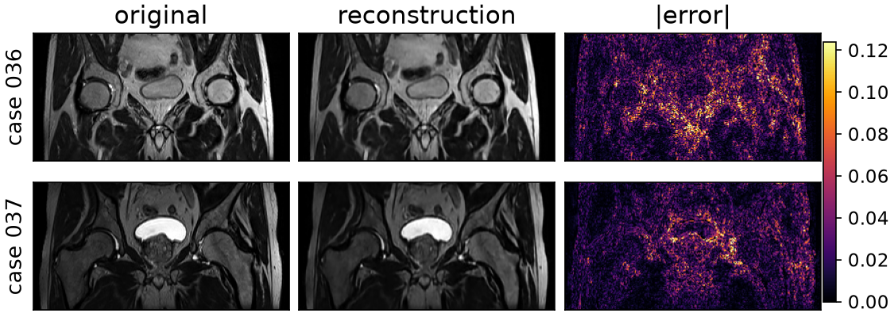

- **Data audit:** 12,660 slices from 38 patients in the HipMRI study (Dowling & Greer, 2021), split by patient (train 11,460 / 31 patients, validate 660 / 4 patients, test 540 / 3 patients).
- **Stage-1 test** (validation): after 6 minutes on an A100, SSIM 0.932 $\pm$ 0.011 and PSNR 31.6 dB.
- **Priors:** ~52 M parameter gated PixelCNN (van den Oord et al., 2016) used, which samples at around 3s per image.

### Risks, Budget & Fallback
| Risk | Warning sign | Mitigation |
|---|---|---|
| Memorisation | Validation NLL rises | Use early stopping to prevent overfitting, and the nearest-neighbour audit |
| Unused Codes | Perplexity of codebook falls | Use EMA updates, and force some random restart of the codebook. |

**Budget:** 1x A100-40GB GPU for training and sampling. 

**Next steps:** 

1. Train the PixelCNN priors for sampling generated images in stage 2.
2. sweep the sampling temperature $T$ and measure FID.
3. Experiment with using some weighted loss that targets SSIM.
